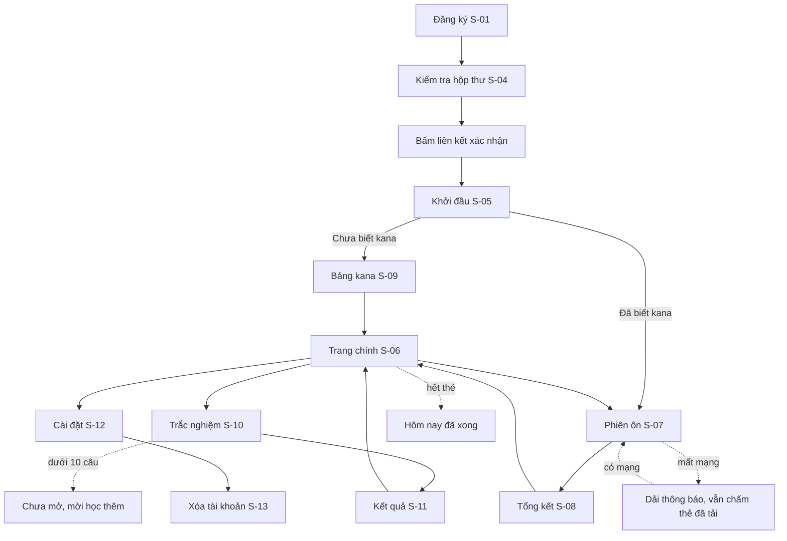

# Thiết kế UX/UI — Nihongo MVP

Trạng thái: Đã chốt quyết định — 17/11/2026

**Hướng v2 "sống động" (18/11/2026, chờ người dùng duyệt).** Người dùng thấy bản v1 hơi chán và có nhiều chữ giải thích nhỏ. Hướng v2 thay đổi: khối màu đậm phẳng (hero nền #1b6e66 chữ trắng), số rất to (96px), vệt dạ quang #ffd84a sau từ khóa, lịch ngày học bằng dấu triện đỏ son #d13b2e chữ 学 xoay nghiêng, bỏ chữ giải thích nhỏ, nút chấm có màu (Được: teal, Dễ: vàng). Chuyển động có chủ đích: lật thẻ 3D, vệt dạ quang quét, thẻ bay theo điểm chấm, đóng dấu triện khi xong phiên; mọi chuyển động có bản tĩnh cho `prefers-reduced-motion`. Tham khảo tinh thần (không chép) từ ximitech.vn: chữ hiển thị lớn, vệt highlight, chuyển động gắn nội dung. Tương phản đã đo: trắng/#1b6e66 6,05; mực/#ffd84a 11,83; #d13b2e/trắng 4,80; vàng/teal 4,37 (chỉ cho số ≥ 24px đậm). Prototype HTML bấm thử: [Nihongo v2](https://claude.ai/artifact/KtKAptQvmsrvRqVz3g9taj) (riêng tư), bản lưu ngoài repo `C:/Users/hai/.local/share/nihongo-prototype/v2/index.html`. Khi được duyệt, mục 5 (token) và các màn sẽ cập nhật theo v2. Hai màn mẫu v2 sinh trên Stitch bị trắng trơn; thiết kế động không thể hiện được trên Stitch/Figma nên prototype HTML là nguồn chính cho v2.

**Bản thiết kế v1: Google Stitch** — project [Nihongo — Wireframe MVP](https://stitch.google.com/projects/8460357221411495285) (tài khoản Google đã kết nối Stitch MCP; trong trình duyệt là tài khoản thứ hai, `/u/1/`). Có đủ 14 màn điện thoại (S-01 đến S-14, S-07 có thêm bản mất mạng) và 4 màn máy tính (S-06, S-07, S-10, S-12), sinh từ đặc tả trong tài liệu này và design system "Nihongo". Đã soát bằng mắt trên canvas: S-06, S-07 (cả bản mất mạng), S-08, S-09, S-10, S-11, S-12, S-13, S-14 bản điện thoại và S-06 bản máy tính; đã sửa chữ dưới 14px, màu chữ phụ #73796e (4,14–4,48:1, không đạt AA) thành #636361, nội dung bịa ở nền S-13, màu sai ở S-11/S-12, tràn cột ở S-06/S-12 máy tính. Chưa soát bằng mắt: S-01 đến S-05 bản điện thoại, S-07/S-10/S-12 bản máy tính. Lưu ý: khi sinh màn, Stitch tự viết lại design system thành bộ "Atelier Crisp" (chữ 11–13px); quy tắc thật nằm ở tài liệu này, mỗi lệnh sinh phải ghi rõ cỡ chữ và màu. Trên canvas còn 4 bản máy tính thừa của S-01 đến S-04 (sinh nhầm khổ), cần xóa tay.

Figma (bản cũ, dừng vì hết lượt gọi Figma MCP gói Starter): [Nihongo — Wireframe MVP](https://www.figma.com/design/3HNM618F5H30e56BehGuqS). Trang "Wireframe điện thoại" có biến màu "Nihongo màu", component nút và nút chấm, cùng 5 khung 390px: S-06 Trang chính, S-07 Phiên ôn (mặt sau thẻ kanji, và bản mất mạng), S-10 Trắc nghiệm, S-12 Cài đặt. Trang "Wireframe máy tính" có 4 khung 1440px: S-06 (thanh bên 224px, tờ nội dung, lưới 12 cột 1100px), S-07 và S-10 (chế độ tập trung, cột 640px, gợi ý phím tắt), S-12 (hai cột 420 + 700px, cột nhãn tóm tắt giá trị hiện tại). Bản máy tính S-06 thêm dòng phân loại thẻ đến hạn ("Từ vựng 14 · Kanji 7 · Kana 3"). Trang điện thoại có thêm S-01 Đăng ký, S-02 Đăng nhập, S-03 Quên mật khẩu (đã gửi), S-04 Kiểm tra hộp thư, S-05 Khởi đầu, S-08 Tổng kết phiên, S-09 Bảng kana. Chưa dựng: S-11 Kết quả trắc nghiệm, S-13 Xóa tài khoản, S-14 Nguồn dữ liệu (dừng vì hết lượt gọi Figma MCP của gói Starter, 17/11/2026). Số liệu trên khung là dữ liệu mẫu, khớp nhau giữa S-06 và S-08: hôm nay đã học 6 thẻ mới (6 XP); phiên ôn 24 thẻ đến hạn + 4 thẻ mới = 28 lượt, nhận 28 + 5 = 33 XP; 19 ngày đã học, chuỗi 6 ngày.

Tài liệu này thuộc giai đoạn 2 (Thiết kế UX/UI) của `docs/00-plan.md`. Nó dựa trên `docs/01-vision.md` (persona) và `docs/02-srs.md` (FR, NFR, US, mục 9). Mã `FR-xx`, `NFR-xx`, `US-xx` trỏ về SRS.

## 1. Nguyên tắc

- Mỗi màn trả lời một câu hỏi chính. Câu hỏi của từng màn nằm ở mục 4.
- Màu chỉ đặt trên dữ liệu và trên một hành động chính mỗi màn. Khung giao diện không màu.
- Không gradient. Không bóng đổ trên thứ đứng yên. Không emoji. Không icon đặt trong ô màu.
- Chữ thân 16px. Chữ phụ tối thiểu 14px. Vùng bấm tối thiểu 44×44px. WCAG 2.1 AA (NFR-04 đến NFR-09).
- Điện thoại là thiết bị chính (persona Lan). Máy tính dùng cùng nội dung với bố cục rộng hơn.
- Không phạt, không trách. Quay lại sau nhiều ngày nghỉ vẫn thấy câu trung tính (US-07, US-11).

### 1.1 Nhận diện riêng của sản phẩm

Ba chi tiết dưới đây làm Nihongo khác một app thẻ học thông thường.

**(a) Thẻ kanji và âm Hán Việt.**
- Chữ kanji đặt rất lớn ở giữa thẻ.
- Ngay dưới là âm Hán Việt viết HOA, theo quy ước sách học chữ Hán của người Việt. Ví dụ 学 → HỌC.
- Đây là cầu nối Hán Việt, điểm khác biệt (b) của sản phẩm (`docs/01-vision.md` mục 6).
- Kanji thiếu âm Hán Việt hiển thị "Đang bổ sung" (FR-14).

**(b) Dải ngày học.**
- Một lưới ô vuông nhỏ, mỗi ô là một ngày học gần nhất.
- Ô có học tô màu nhấn. Ô không học để trống.
- Số chính đi kèm là "tổng số ngày đã học". Chuỗi ngày là số phụ, nhỏ hơn (FR-22).
- Ô trống không dùng màu đỏ hay dấu nhắc nhở.

**(c) Lời chào nói một sự thật hôm nay.**
- H1 trang chính nói một sự thật hôm nay, không có tên người học (giữ dữ liệu tối thiểu, NFR-15). Ví dụ: "Hôm nay có 24 thẻ đến hạn, khoảng 8 phút."
- Hết thẻ: "Hôm nay đã xong. Ngày mai có 18 thẻ."
- Không dùng "Chào mừng trở lại". Không emoji.
- Số trong ví dụ chỉ để minh họa kiểu câu, không phải dữ liệu thật.
- Thời gian ước tính = số thẻ trong hàng đợi × trung vị số giây mỗi lượt ôn của chính người học trong 7 ngày gần nhất, làm tròn lên theo phút. Người chưa có đủ dữ liệu dùng mặc định 20 giây mỗi thẻ (giả định, kiểm lại sau thử nghiệm).

## 2. User flow

### 2.1 Lần đầu

1. Đăng ký (S-01).
2. Kiểm tra hộp thư (S-04).
3. Bấm liên kết xác nhận trong email.
4. Khởi đầu (S-05), ba bước trên một màn:
   1. Chọn cấp N5 hoặc N4.
   2. Đã biết kana chưa.
   3. Mục tiêu thẻ mới (mặc định 10) và ngày thi (tùy chọn).
5. Bài đầu tiên:
   - Chưa biết kana: bảng kana (S-09).
   - Đã biết kana: phiên ôn với thẻ mới (S-07).

### 2.2 Hằng ngày

1. Mở app.
2. Trang chính (S-06).
3. Bấm "Bắt đầu ôn" (một thao tác, FR-21).
4. Phiên ôn (S-07).
5. Tổng kết phiên (S-08).
6. Về trang chính (S-06).

### 2.3 Luồng phụ

- Trắc nghiệm: S-10, rồi S-11.
- Bảng kana: S-09.
- Cài đặt (S-12): đổi cấp, mục tiêu, giới hạn ôn, ngày thi, đăng xuất, xóa tài khoản (S-13).
- Nguồn dữ liệu (S-14): mở được khi chưa đăng nhập.

### 2.4 Nhánh lỗi

- Mất mạng giữa phiên (FR-26 đến FR-28, FR-30): dải thông báo trên thẻ, vẫn chấm được thẻ đã tải. Chi tiết ở S-07.
- Hết thẻ hôm nay: S-06 báo "Hôm nay đã xong", nút chính không còn là "Bắt đầu ôn".
- Trắc nghiệm chưa mở (chưa đủ 10 câu hợp lệ, FR-19): S-10 báo lý do và mời học thêm thẻ.
- Liên kết xác nhận hoặc đặt lại hết hạn sau 1 giờ: cho gửi lại (S-04, S-03).
- Vượt giới hạn tần suất (NFR-24): thông báo tạm thời ngay trên biểu mẫu.

## 3. Khung điều hướng (shell)

### 3.1 Máy tính (từ 1100px)

- Sidebar rộng 224px bên trái, cùng nền với thanh trên: #f7f6f2 (tông giấy ấm).
- Nội dung nằm trên một "tờ" trắng, cách mép phải và mép dưới 8px, bo 16px, viền 1px #eaeaea, không bóng.
- Đầu sidebar: logo chữ "Nihongo" và dấu nhận diện (chữ 日 trong ô bo tròn màu nhấn).
- Các mục chính: Trang chính, Ôn tập, Kana, Trắc nghiệm.
- Dưới cùng: Cài đặt, Nguồn dữ liệu, tài khoản.
- Mục đang chọn: viên thuốc xám trung tính (#eeeeee). Không có thanh màu bên trái.

### 3.2 Máy tính bảng (641 đến 1099px)

- Sidebar gập thành thanh trên cao 48px, có nút menu.
- Bấm nút menu mở danh sách mục như sidebar.
- Nút menu vẫn có vùng bấm 44×44px.

### 3.3 Điện thoại (dưới 641px)

- Thanh dưới có 4 mục: Trang chính, Ôn tập, Kana, Trắc nghiệm. Mỗi mục cao tối thiểu 56px và có nhãn chữ.
- Cài đặt nằm ở thanh trên.
- Màn rộng tối thiểu 360px, không cuộn ngang (NFR-20).

- "Nguồn dữ liệu" trên điện thoại: mục cuối trong Cài đặt, và liên kết ở chân trang S-01, S-02 (mở được khi chưa đăng nhập, FR-29).

### 3.4 Chế độ tập trung

- Phiên ôn (S-07) và trắc nghiệm (S-10) chiếm toàn màn hình.
- Ẩn sidebar và thanh dưới.
- Chỉ còn nút thoát, tiến độ (ví dụ "12 / 24") và trạng thái mạng.
- Thoát giữa chừng: các lượt đã chấm vẫn giữ (UC-02 8a), các câu trắc nghiệm đã trả lời vẫn tính XP (UC-04 3a).

## 4. Danh sách màn hình

| Mã | Tên | Câu hỏi chính | Nội dung chính | Hành động chính | FR / US |
|---|---|---|---|---|---|
| S-01 | Đăng ký | Tôi tạo tài khoản bằng cách nào? | Email, mật khẩu (tối thiểu 8 ký tự), liên kết sang đăng nhập, liên kết Nguồn dữ liệu | Tạo tài khoản | FR-01 / US-01 |
| S-02 | Đăng nhập | Tôi vào lại tài khoản thế nào? | Email, mật khẩu, "Quên mật khẩu?", "Chưa nhận email xác nhận?" | Đăng nhập | FR-02 / US-01, US-02 |
| S-03 | Quên mật khẩu / đặt lại | Tôi lấy lại quyền vào tài khoản ra sao? | Bước 1: nhập email. Bước 2 (từ liên kết trong email): nhập mật khẩu mới | Gửi liên kết / Đặt mật khẩu mới | FR-04 / US-02 |
| S-04 | Kiểm tra hộp thư | Tôi cần làm gì tiếp theo? | Câu "Hãy kiểm tra hộp thư của bạn", nút gửi lại email, báo liên kết hết hạn sau 1 giờ | Gửi lại email | FR-01, FR-02 / US-01 |
| S-05 | Khởi đầu | Tôi bắt đầu từ đâu? | Ba bước trên một màn: cấp, đã biết kana chưa, mục tiêu và ngày thi | Bắt đầu học | FR-06, FR-07, FR-08, FR-11 / US-03, US-05, US-12 |
| S-06 | Trang chính | Hôm nay tôi cần ôn gì và mất bao lâu? | H1 sự thật hôm nay, "Ôn hôm nay", "Ngày học", "Ngày thi", "XP" | Bắt đầu ôn | FR-16, FR-21 đến FR-24 / US-07, US-10 đến US-12 |
| S-07 | Phiên ôn (mặt trước, mặt sau) | Tôi có nhớ thẻ này không? | Thẻ, nút lật, 4 nút chấm, tiến độ, trạng thái mạng | Lật thẻ, rồi chấm | FR-12 đến FR-18, FR-26 đến FR-28 / US-06, US-08, US-14 |
| S-08 | Tổng kết phiên | Phiên này tôi làm được gì? | Số thẻ đã ôn, thời gian, XP nhận được, tiến độ thẻ mới, thông báo xong mục tiêu | Về trang chính | FR-18, FR-22, FR-23 / US-06, US-10 |
| S-09 | Bảng kana | Chữ này đọc thế nào? | Hai tab hiragana và katakana, lưới chữ theo nhóm (46, 25, 33 âm ghép), ô chi tiết chữ và romaji | Chọn một chữ để xem cách đọc | FR-10, FR-11 / US-04 |
| S-10 | Trắc nghiệm | Tôi có nhận ra đáp án đúng không? | Câu hỏi, 4 lựa chọn, tiến độ "n / 10" | Chọn đáp án, rồi "Câu tiếp" | FR-19, FR-20, FR-23 / US-09 |
| S-11 | Kết quả trắc nghiệm | Tôi làm đúng bao nhiêu câu? | Số câu đúng trên 10, XP nhận được, danh sách câu sai kèm đáp án đúng | Về trang chính / Làm bài khác | FR-19, FR-23 / US-09 |
| S-12 | Cài đặt | Tôi muốn học bao nhiêu mỗi ngày? | Học tập, Tài khoản, Vùng nguy hiểm | Đổi một thiết lập (tự lưu) | FR-03, FR-05 đến FR-08, FR-25 / US-02, US-03, US-05, US-12, US-13, US-15 |
| S-13 | Xóa tài khoản | Tôi có chắc muốn xóa toàn bộ dữ liệu không? | Hộp xác nhận: nêu dữ liệu sẽ mất, ô nhập lại mật khẩu | Xóa tài khoản (nút nguy hiểm) / Hủy | FR-05, FR-30 / US-15 |
| S-14 | Nguồn dữ liệu và giấy phép | Dữ liệu này từ đâu ra? | Danh sách nguồn kèm tác giả, giấy phép, ngày tải; giấy phép dữ liệu tách khỏi MIT của mã nguồn | Đọc (không có hành động) | FR-29, NFR-23 / US-16 |

### 4.1 S-06 Trang chính

Câu hỏi: "Hôm nay tôi cần ôn gì và mất bao lâu?"

**Bố cục máy tính.**
- Cột nội dung ở giữa, rộng tối đa 1100px.
- Lưới 12 cột: cột 77px, khe 16px.

**Thứ tự khối từ trên xuống.**
1. **H1 sự thật hôm nay** (không có tên người học).
   - Chữ serif. Cỡ 40px trên máy tính, 28px trên điện thoại.
   - Dòng xám bên dưới ghi ngày hôm nay (chữ phụ, tối thiểu 14px).
2. **Hàng giữa.**
   - Khối "Ôn hôm nay" chiếm 9 cột. Nội dung: số thẻ đến hạn, số thẻ mới còn lại so với mục tiêu (ví dụ "6 / 10 thẻ mới"), thời gian ước tính, nút chính "Bắt đầu ôn".
   - Nút chính: nền gần đen #1f201d, chữ trắng, cao 48px, bo tròn hoàn toàn. Đây là hành động chính duy nhất của màn.
   - Thanh tiến độ thẻ mới dùng màu nhấn (đóng góp vào tỉ lệ dưới 2% điểm ảnh).
   - Khối "Ngày học" chiếm 3 cột bên phải. Nội dung: tổng số ngày đã học (số lớn 32px, độ đậm 400), chuỗi ngày (số phụ, nhỏ hơn), dải ngày học 5 tuần gần nhất (35 ô).
3. **Hàng dưới (6 + 6 cột).**
   - "Ngày thi": đếm ngược (FR-24). Chưa đặt ngày thi thì một dòng ngắn và nút chữ "Đặt ngày thi".
   - "XP": tổng XP và XP hôm nay.
4. Không có thẻ KPI kèm icon.
5. Nhận diện kanji và Hán Việt thể hiện ở thẻ trong phiên ôn (S-07), không có khối riêng trên trang chính.

**Điện thoại.** Các khối xếp một cột theo thứ tự trên. Nút "Bắt đầu ôn" rộng bằng khối và nằm trong tầm ngón cái khi cuộn tới.

**Dải ngày học.**
- Có dòng chữ thay thế cho trình đọc màn hình, ví dụ "Đã học 18 trong 35 ngày gần nhất".
- Ngày hôm nay có viền để phân biệt, không dựa vào màu.

**Trạng thái.**

| Trạng thái | Hiển thị |
|---|---|
| Bình thường | Như mô tả trên |
| Chưa có thẻ đến hạn, đã đạt mục tiêu thẻ mới | "Hôm nay đã xong. Ngày mai có 18 thẻ." Nút chính ẩn, thay bằng liên kết "Làm trắc nghiệm" |
| Lần đầu (chưa có lượt ôn) | H1 nói số thẻ mới hôm nay và thời gian ước tính (mặc định 20 giây/thẻ). Khối "Ngày học" hiện "0" và dải ô trống. Nút chính "Bắt đầu học" |
| Hết thẻ mới mọi loại của cấp | Thông báo một câu, kèm nút "Chuyển sang N4" (FR-06). Chỉ hiện khi đang chọn N5 |
| Quá ngày thi | Một câu mời đặt ngày mới hoặc xóa (FR-24) |
| Đang tải | Các thanh xám đúng kích thước khối, không nhấp nháy mạnh |
| Lỗi trong khối | Chỉ khối lỗi hiện một câu và nút "Thử lại"; các khối khác vẫn dùng được |

Không có nút "Học thêm" trong MVP (FR-13 không cho vượt mục tiêu thẻ mới).

### 4.2 S-07 Phiên ôn

Câu hỏi: "Tôi có nhớ thẻ này không?"

**Chế độ.** Toàn màn hình (xem mục 3.4).

**Thứ tự khối từ trên xuống.**
1. **Thanh trên.**
   - Nút thoát (44×44px) ở trái.
   - Tiến độ ở giữa: "12 / 24".
   - Chấm trạng thái mạng ở phải, kèm nhãn chữ "Có mạng" hoặc "Mất mạng" (màu không phải thông tin duy nhất).
2. **Dải thông báo mất mạng** (chỉ khi mất mạng), nằm trên thẻ. Chi tiết bên dưới.
3. **Thẻ** ở giữa.
4. **Vùng nút** ở dưới cùng, trong tầm ngón cái trên điện thoại.

**Ba loại thẻ.**

| Loại | Mặt trước | Mặt sau (thêm) |
|---|---|---|
| Từ vựng | Từ tiếng Nhật, 48px (Noto Sans JP) | Cách đọc kana; nghĩa tiếng Việt 20px; câu ví dụ nếu có (FR-12) |
| Kanji | Chữ kanji 120px (Klee One) | Âm Hán Việt viết HOA 28px; nghĩa tiếng Việt; on/kun 16px; từ ví dụ (FR-14) |
| Kana | Chữ 96px | Romaji |

- Kanji thiếu âm Hán Việt: hiển thị "Đang bổ sung".
- Kanji không có từ ví dụ: hiển thị "Chưa có từ ví dụ".
- Kanji có nhiều âm Hán Việt: một âm chính cỡ 28px, các âm còn lại dạng phụ cỡ 14px.
- Mọi đoạn tiếng Nhật đặt `lang="ja"` (NFR-11).

**Nút chấm.**
- Trước khi lật: một nút rộng "Lật thẻ" (phím Space).
- Sau khi lật: 4 nút cùng hàng: Lại, Khó, Được, Dễ.
- Mỗi nút cao tối thiểu 56px. Có nhãn, và bên dưới nhãn là khoảng ôn kế tiếp bằng chữ 14px. Ví dụ minh họa: "10 phút", "1 ngày", "3 ngày", "8 ngày". Khoảng thật do `ts-fsrs` tính cho từng thẻ.
- "Được" là nút chính, màu gần đen. Ba nút còn lại nền xám nhạt.
- Không tô đỏ hay xanh cho từng nút: màu không mang nghĩa đúng/sai ở đây.
- Phím 1, 2, 3, 4 chọn Lại, Khó, Được, Dễ (NFR-06). Hiện số phím nhỏ trên máy tính.
- Chấm xong chuyển thẻ kế tiếp trong ≤ 200 ms, không chờ mạng (NFR-03).

**Mất mạng.**
- Dải thông báo phía trên thẻ: "Đang mất mạng. Kết quả được lưu trên máy và sẽ tự gửi khi có mạng."
- Màu dải: nền #fffbeb, viền #fde68a, chữ #92400e.
- Dải không chặn việc chấm.
- Khi có mạng lại và đã gửi xong, dải đổi thành "Đã đồng bộ" rồi tự ẩn.
- Hết thẻ trong phiên đã tải khi còn offline: báo cần mạng để tải thẻ mới (FR-28). Không có nút tải thẻ mới.

**Thoát giữa chừng.** Hộp xác nhận một câu: "Thoát phiên? Các thẻ đã chấm vẫn được giữ." Hai nút: "Ở lại", "Thoát".

Không có hoàn tác lượt chấm trong MVP.

### 4.3 S-10 Trắc nghiệm

Câu hỏi: "Tôi có nhận ra đáp án đúng không?"

**Chế độ.** Toàn màn hình, 10 câu (FR-19).

**Thứ tự khối từ trên xuống.**
1. Thanh trên: nút thoát (44px), tiến độ "3 / 10".
2. Câu hỏi cỡ lớn. Ba dạng: từ → nghĩa, nghĩa → từ, kanji → âm Hán Việt.
3. 4 lựa chọn dạng hàng, mỗi hàng cao tối thiểu 56px, rộng hết cột.
4. Nút "Câu tiếp" (nút chính), chỉ hiện sau khi đã chọn.

**Sau khi chọn.**
- Đáp án đúng: viền đậm và nhãn "Đúng", chữ nhãn #2e7d32.
- Lựa chọn sai đã chọn: nhãn "Sai", chữ nhãn #b42318.
- Đây là nơi duy nhất dùng màu đúng/sai. Luôn có chữ đi kèm, không chỉ màu.
- Khóa các lựa chọn sau khi chọn. Phím 1 đến 4 chọn lựa chọn, Enter đi tiếp.
- Báo cho trình đọc màn hình bằng vùng `aria-live`.

**Chưa mở.** Điều kiện mở theo FR-19: tạo được ít nhất 10 câu hợp lệ. Khi chưa đủ: một câu "Cần học thêm vài thẻ để mở trắc nghiệm." kèm nút "Bắt đầu ôn". Không nêu số.

### 4.4 S-12 Cài đặt

Câu hỏi: "Tôi muốn học bao nhiêu mỗi ngày?"

**Bố cục máy tính.** Hai cột.
- Cột trái là cột nhãn, rộng khoảng 450px. Mỗi mục có tiêu đề (16px, độ đậm 500) và mô tả xám 14px.
- Cột phải là bảng rộng khoảng 700px, nền `--surface` (#f9f9f9), bo 16px, không viền.

**Trên điện thoại.** Một cột: nhãn trên, bảng dưới.

**Các mục.**

1. **Học tập.**
   - Cấp (N5 hoặc N4). Mô tả nói rõ: đổi cấp chỉ đổi nguồn thẻ mới, thẻ đã học vẫn đến hạn (FR-06).
   - Đã biết kana (công tắc).
   - Mục tiêu thẻ mới mỗi ngày (5 đến 30, mặc định 10).
   - Giới hạn ôn mỗi ngày (50 đến 500, mặc định 100).
   - Ngày thi (tùy chọn, có nút "Xóa ngày thi"; từ chối ngày trong quá khứ).
2. **Tài khoản.**
   - Email (chỉ đọc).
   - Đổi mật khẩu.
   - Đăng xuất.
3. **Ứng dụng.** Hướng dẫn cài lên màn hình chính, gồm các bước cho Safari iOS (FR-25).
4. **Nguồn dữ liệu.** Liên kết sang S-14 (mục cuối trước vùng nguy hiểm trên điện thoại).
5. **Vùng nguy hiểm** (cuối cùng).
   - Nút "Xóa tài khoản" viền màu #b42318, nền trắng.
   - Mô tả nói rõ hậu quả: xóa email, trạng thái thẻ, log ôn, cài đặt, XP và chuỗi; không hoàn tác được.

**Tự lưu.**
- Mỗi điều khiển tự lưu khi đổi và hiện dấu "Đã lưu" cạnh điều khiển.
- Giá trị ngoài khoảng: không lưu, giữ giá trị cũ, báo lỗi dưới ô nhập ("Mục tiêu từ 5 đến 30 thẻ").
- Lưu thất bại: hiện "Chưa lưu được. Thử lại" cạnh điều khiển.

**Xem trước kết quả.** Bên cạnh mục tiêu có một dòng: "Với 10 thẻ mới mỗi ngày, bạn học hết thẻ mới của cấp N5 trong khoảng N ngày".
- Công thức: N = làm tròn lên của (số thẻ mới còn lại của cấp ÷ mục tiêu thẻ mới mỗi ngày).
- Dòng này tính lại ngay khi đổi mục tiêu.
- Không hiện số khi chưa tính được. Không bịa số.

Mục "Ứng dụng" (hướng dẫn cài PWA, FR-25) nằm trong Cài đặt.

**Hộp xác nhận đăng xuất (FR-30).** Khi còn lượt ôn chưa gửi:
- Có mạng: gửi trước rồi đăng xuất, hiện "Đang gửi kết quả ôn..."
- Mất mạng: cảnh báo "Còn N lượt ôn chưa gửi. Đăng xuất lúc này sẽ mất các lượt đó." Hai nút: "Ở lại", "Đăng xuất và xóa".

### 4.5 Các màn còn lại

**S-01 Đăng ký.**
- Không có shell. Một khối đặt giữa màn, rộng tối đa 400px.
- Ô email, ô mật khẩu (có nút hiện/ẩn, gợi ý "Tối thiểu 8 ký tự").
- Nút chính "Tạo tài khoản". Dưới là liên kết "Đã có tài khoản? Đăng nhập" và liên kết "Nguồn dữ liệu".
- Gửi xong, luôn chuyển sang S-04, kể cả khi email đã tồn tại (FR-01).
- Lỗi mật khẩu dưới 8 ký tự hiện dưới ô, báo "Mật khẩu cần tối thiểu 8 ký tự".

**S-02 Đăng nhập.**
- Cùng khung với S-01. Ô email, ô mật khẩu, nút chính "Đăng nhập".
- Lỗi sai thông tin chỉ hiện một câu chung, không nói email có tồn tại hay không. Bên dưới có liên kết "Chưa nhận email xác nhận?" (FR-02).
- Liên kết "Quên mật khẩu?" dẫn tới S-03.
- Vượt giới hạn tần suất: câu tạm thời "Thử quá nhiều lần. Vui lòng đợi rồi thử lại." (NFR-24).

**S-03 Quên mật khẩu / đặt lại.**
- Bước 1: một ô email và nút "Gửi liên kết". Thông báo sau khi gửi luôn giống nhau dù email có tồn tại hay không (FR-04).
- Bước 2 (mở từ liên kết trong email): hai ô mật khẩu mới (nhập và nhập lại), nút "Đặt mật khẩu mới". Liên kết hết hạn thì hiện câu báo và nút quay lại bước 1.
- Đặt xong, chuyển sang S-02 kèm câu "Đã đặt mật khẩu mới".

**S-04 Kiểm tra hộp thư.**
- Một câu chính "Hãy kiểm tra hộp thư của bạn", một dòng phụ nói liên kết hết hạn sau 1 giờ.
- Nút phụ "Gửi lại email". Thông báo sau khi gửi lại luôn giống nhau (FR-02). Nút bị khóa tạm thời có đếm ngược chữ khi gặp giới hạn tần suất.
- Liên kết "Quay lại đăng nhập".

**S-05 Khởi đầu.**
- Ba bước trên một màn, hiện lần lượt từ trên xuống, cùng một trang cuộn. Đầu màn có chỉ báo chữ "Bước 1 / 3".
- Bước 1: hai lựa chọn lớn N5 và N4 (nhóm nút chọn một, vùng bấm tối thiểu 56px).
- Bước 2: "Bạn đã biết kana chưa?" với hai lựa chọn "Chưa biết" và "Đã biết".
- Bước 3: số thẻ mới mỗi ngày (mặc định 10, 5 đến 30) và ngày thi (tùy chọn). Có một dòng phụ "Giới hạn ôn: 100 lượt mỗi ngày. Đổi trong Cài đặt."
- Nút chính "Bắt đầu học" mở bài đầu tiên (S-09 nếu chưa biết kana, S-07 nếu đã biết).
- Chưa chọn xong bước 1 và 2 thì nút bị khóa và có dòng giải thích.

**S-08 Tổng kết phiên.**
- Không còn chế độ tập trung. Có shell.
- Một câu đầu nêu sự thật: "Bạn đã ôn 24 thẻ trong 8 phút." (số lấy từ dữ liệu phiên, `session_id`, FR-17).
- Dưới là: XP nhận được, thẻ mới đã học so với mục tiêu, tổng số ngày đã học.
- Khi vừa đạt mục tiêu thẻ mới: một dòng "Đã xong mục tiêu thẻ mới hôm nay" (FR-13), kèm +5 XP lần đầu trong ngày học (FR-23).
- Khi hết thẻ mới mọi loại: đề nghị chuyển cấp (FR-06).
- Nút chính "Về trang chính".

**S-09 Bảng kana.**
- Hai tab: Hiragana và Katakana. Dưới là ba nhóm: 46 chữ cơ bản, 25 âm đục và bán đục, 33 âm ghép (FR-10).
- Lưới chữ, mỗi ô là một nút tối thiểu 44×44px. Trên 360px lưới cơ bản có 5 cột.
- Chọn một chữ mở ô chi tiết: chữ lớn (96px) và cách đọc bằng chữ La-tinh. Trên điện thoại là tấm trượt từ dưới lên, trên máy tính là khối bên phải.
- Người chưa biết kana vào đây ở bài đầu tiên. Nút "Bắt đầu ôn kana" dẫn tới S-07 khi có thẻ kana mới (FR-11).
- Người đã chọn "đã biết kana" vẫn xem được bảng, nhưng không có nút đưa thẻ kana vào hàng đợi.

**S-11 Kết quả trắc nghiệm.**
- Số câu đúng ghi bằng chữ, ví dụ "7 / 10 câu đúng", kèm XP nhận được (+1 mỗi câu đúng, FR-23).
- Danh sách các câu sai: câu hỏi, đáp án đã chọn, đáp án đúng. Không phạt, không trách.
- Dòng chữ nhắc: "Trắc nghiệm không thay đổi lịch ôn." (FR-20).
- Hai nút: "Về trang chính" (chính) và "Làm bài khác".

**S-13 Xóa tài khoản.**
- Hộp xác nhận hiện trên lớp phủ, mở từ S-12. Tiêu đề "Xóa tài khoản?".
- Nội dung: liệt kê dữ liệu sẽ mất (email, trạng thái thẻ, log ôn, cài đặt, XP, chuỗi), nói không hoàn tác được, và bản sao lưu của nhà cung cấp còn giữ dữ liệu đến khi hết hạn theo chu kỳ của họ (NFR-17).
- Một ô nhập lại mật khẩu. Nút "Xóa tài khoản" (nguy hiểm) và nút "Hủy".
- Sai mật khẩu: báo lỗi dưới ô, không xóa gì (US-15). Xóa lỗi giữa chừng: báo lỗi, không báo "đã xóa", cho thử lại (UC-06 4a).
- Thành công: đăng xuất, về S-02 kèm câu "Tài khoản đã được xóa".
- Hộp bẫy focus bên trong, Esc đóng, focus quay về nút đã mở hộp.

**S-14 Nguồn dữ liệu và giấy phép.**
- Mở được khi chưa đăng nhập. Có shell tối giản khi chưa đăng nhập (chỉ logo và liên kết "Đăng nhập").
- Bảng nguồn: tên, tác giả, giấy phép, ngày tải. Gồm JMdict và KANJIDIC2 (EDRDG, CC BY-SA), danh sách của Jonathan Waller tại tanos.co.uk ("CC BY theo nguồn thứ cấp, chưa đọc được trang gốc"), Tatoeba (CC BY, chỉ khi được đưa vào dữ liệu), nghĩa tiếng Việt do dự án tự biên soạn.
- Một đoạn nêu dữ liệu dẫn xuất từ JMdict/KANJIDIC2 theo CC BY-SA, tách khỏi giấy phép MIT của mã nguồn.
- Ngày tải lấy từ dữ liệu thật khi nhập, không điền trước.

## 5. Design system (token)

### 5.1 Màu

Tỉ lệ tương phản là số đã đo (NFR-09). Vẫn đo lại bằng công cụ khi dựng giao diện thật.

| Token | Giá trị | Vai trò | Tương phản đã đo |
|---|---|---|---|
| `--ground` | #ffffff | Tờ nội dung | Nền |
| `--chrome` | #f7f6f2 | Sidebar, thanh trên (tông giấy ấm) | Nền |
| `--surface` | #f9f9f9 | Bảng một nấc khác nền (bảng Cài đặt dùng token này) | Nền |
| `--raised` | #ffffff | Khối nổi trên nền surface | Nền |
| `--active` | #eeeeee | Mục đang chọn trong sidebar | Nền |
| `--border` | #eaeaea | Viền tờ nội dung và khối; không dùng cho điều khiển | Trang trí |
| `--rule` | #f3f3f3 | Đường kẻ rất nhạt giữa hàng | Trang trí |
| `--control` | #8c8c88 | Viền ô nhập và điều khiển, rãnh công tắc tắt | 3,39:1 trên #ffffff (đạt WCAG 1.4.11, ≥ 3:1) |
| `--text` | #1f201d | Chữ chính | 16,37:1 trên #ffffff |
| `--muted` | #636361 | Chữ phụ | 6,02:1 trên #ffffff; 5,57:1 trên #f7f6f2; 5,72:1 trên #f9f9f9; 5,19:1 trên #eeeeee |
| `--primary` | #1f201d | Nút chính (chữ trắng) | 16,37:1 (#ffffff trên #1f201d) |
| `--accent` | #1b6e66 | Xanh mòng két đậm: ô ngày đã học, dấu nhận diện, thanh tiến độ thẻ mới | 6,05:1 trên #ffffff; 5,60:1 trên #f7f6f2 |
| `--positive` | #2e7d32 | Chữ nhãn "Đúng" (chỉ trong trắc nghiệm) | 5,13:1 trên #ffffff |
| `--negative` | #b42318 | Chữ nhãn "Sai", nút xóa tài khoản | 6,57:1 trên #ffffff |

Dải cảnh báo: nền #fffbeb, viền #fde68a, chữ #92400e (6,84:1 trên #fffbeb).

Viên trạng thái nhạt:

| Loại | Nền | Chữ | Tương phản đã đo |
|---|---|---|---|
| Tích cực | #dcfae5 | #04250e | 14,77:1 |
| Tiêu cực | #fdecea | #7a1d14 | 9,12:1 |
| Trung tính | #f3f3f3 | #3d3d3a | 9,82:1 |

Quy tắc dùng màu:
- Màu nhấn `--accent` dùng dưới 2% điểm ảnh.
- Không dùng tím hay chàm. Không dùng kem kết hợp đất nung.
- Công tắc dùng #1f201d khi bật, không dùng màu nhấn.
- Mọi trạng thái đều có chữ đi kèm, không chỉ màu (NFR-09).

Chế độ tối để sau MVP. Token đặt tên theo vai trò để thêm sau được.

### 5.2 Kiểu chữ

| Vai trò | Font | Ghi chú |
|---|---|---|
| Giao diện | Be Vietnam Pro (Google Fonts, SIL OFL, thiết kế cho tiếng Việt) | Độ đậm 400, 500, 600. Số dạng tabular cho mọi con số cập nhật |
| Lời chào | Noto Serif (đề xuất, OFL, hỗ trợ tiếng Việt) | Chỉ cho h1 lời chào trang chính |
| Từ vựng và kana | Noto Sans JP (OFL) | `lang="ja"` (NFR-11) |
| Kanji cỡ lớn trên thẻ kanji | Klee One (OFL, nét gần chữ viết tay sách giáo khoa) | `lang="ja"` |

Thang cỡ chữ:

| Cỡ | Dùng cho |
|---|---|
| 14px | Chữ phụ, nhãn (tối thiểu) |
| 16px | Chữ thân |
| 20px | Nghĩa trên thẻ |
| 24px | Tiêu đề màn |
| 32px | Số chính |
| 40px | Lời chào trên máy tính (28px trên điện thoại) |
| 48px | Từ vựng trên thẻ |
| 96px | Kana trên thẻ |
| 120px | Kanji trên thẻ |

- Không chữ nào dưới 14px.
- Không dùng chữ hoa giãn cách cho nhãn. Âm Hán Việt viết HOA là ngoại lệ có chủ đích và không giãn cách.
- Kiểm hiển thị dấu tiếng Việt, kana và kanji trên cả bốn trình duyệt (NFR-10). Chuẩn bị font dự phòng cho kanji nếu Klee One thiếu chữ.

**Nạp font** (để đạt LCP ≤ 2,5 giây, NFR-01):
- Dùng `next/font`, tự host khi build, `font-display: swap`.
- Be Vietnam Pro và Noto Serif: tập con latin và vietnamese.
- Noto Sans JP: nạp theo `unicode-range`.
- Klee One: chỉ tải ở màn phiên ôn.

### 5.3 Khoảng cách và hình khối

- Lưới 4px. Khe 16px. Đệm khối 20px.
- Bo khối 22px. Bo tờ nội dung 16px. Nút bo tròn hoàn toàn (999px).
- Điều khiển cao 44px. Nút chính cao 48px. Hàng danh sách cao 63px.
- Không bóng đổ trên phần tử đứng yên.

### 5.4 Focus

- Vòng 2px màu #1f201d, cách phần tử 2px.
- Luôn nhìn thấy, trên cả nền trắng, nền #f7f6f2 và trên nút nền gần đen (khe 2px cho vòng không chìm vào nút).
- Thứ tự focus theo thứ tự đọc (NFR-06).

### 5.5 Thành phần

Trạng thái chung: hover (đổi nền một nấc, không đổi màu chữ), focus (vòng ở mục 5.4), disabled (chữ và viền nhạt hơn, `aria-disabled`, có dòng giải thích khi cần).

**Nút.**
- Chính: nền #1f201d, chữ trắng, cao 48px, bo 999px. Mỗi màn chỉ một nút chính.
- Phụ: nền xám nhạt, chữ #1f201d, cao 44px.
- Chữ: không nền, gạch chân khi hover, vùng bấm vẫn tối thiểu 44×44px.
- Nguy hiểm: viền và chữ #b42318, nền trắng. Chỉ dùng cho xóa tài khoản và "Đăng xuất và xóa".

**Ô nhập.**
- Nhãn ở trên, 14px độ đậm 500.
- Viền `--control` (#8c8c88, 3,39:1 trên trắng), cao 44px.
- Lỗi hiện dưới ô, chữ #b42318, gắn `aria-describedby` và `aria-invalid`.
- Hover: viền đậm một nấc. Focus: vòng focus. Disabled: nền #f3f3f3.

**Công tắc.**
- Màu bật #1f201d (không dùng màu nhấn). Rãnh tắt `--control` (#8c8c88).
- Vùng bấm tối thiểu 44×44px. Có nhãn chữ "Bật" hoặc "Tắt" hoặc nhãn của chính mục đó, để không chỉ dựa vào vị trí.

**Thẻ học (3 loại).**
- Từ vựng, kanji, kana. Kích thước chữ theo mục 4.2.
- Mặt trước chỉ có chữ cần nhớ. Mặt sau thêm thông tin. Chuyển mặt không dùng hiệu ứng lật quay; đổi nội dung tức thì (tôn trọng `prefers-reduced-motion`).
- Thẻ kanji luôn có dòng âm Hán Việt (HOA) hoặc "Đang bổ sung".
- Vùng thẻ không có bóng, viền 1px #eaeaea, bo 22px.

**Nút chấm 4 mức.**
- Lại, Khó, Được, Dễ. Cao tối thiểu 56px, cùng hàng, mỗi nút chiếm một phần tư bề rộng.
- Nhãn và khoảng ôn kế tiếp (14px). "Được" nền gần đen. Ba nút còn lại nền xám nhạt.
- Hiện số phím (1 đến 4) trên máy tính.
- Disabled: trước khi lật thẻ, các nút này không hiện (chỉ có "Lật thẻ").

**Dải ngày học.**
- Lưới ô vuông 5 tuần (35 ô). Hàng là tuần, cột là thứ trong tuần.
- Ô có học tô `--accent`. Ô không học để trống, chỉ có viền `--rule`. Ngày hôm nay có viền đậm.
- Có chữ thay thế tổng quát (xem mục 4.1). Mỗi ô có nhãn ngày cho trình đọc màn hình.

**Dải thông báo.**
- Mất mạng: màu cảnh báo (nền #fffbeb, viền #fde68a, chữ #92400e).
- Đã đồng bộ: viên trạng thái tích cực (#dcfae5, chữ #04250e), tự ẩn sau vài giây.
- Dùng `role="status"`, không cướp focus.

**Hộp xác nhận.**
- Lớp phủ mờ đơn sắc, khối trắng giữa màn, rộng tối đa 440px.
- Tiêu đề, nội dung, hai nút. Nút hủy nằm cạnh nút hành động.
- Bẫy focus, Esc đóng, trả focus về nút đã mở.
- Dùng cho: xóa tài khoản, thoát phiên ôn, đăng xuất khi còn lượt chưa gửi.

**Trạng thái rỗng, đang tải, lỗi.**
- Nguyên tắc chung: giữ nguyên khung của khối, chỉ một câu, không hình minh họa.
- Rỗng: một câu nói rõ việc kế tiếp, kèm một nút nếu có hành động.
- Đang tải: thanh xám đúng kích thước nội dung sẽ đến, tránh nhảy bố cục.
- Lỗi: một câu nói chuyện gì xảy ra và nút "Thử lại". Không hiện mã lỗi kỹ thuật.

## 6. Thử nghiệm prototype

Mục đích: kiểm tra các giả định về persona và về cầu nối Hán Việt (`docs/01-vision.md` mục 4 và mục 6 (b)) trước khi lập trình giao diện.

**Người tham gia.** 3 đến 5 người. Gợi ý tìm đúng 3 nhóm persona: người ôn N3 (như Minh), người đi làm nhắm N4 (như Lan), người mới học N5 (như Hùng).

**Prototype.** Dựng trên Figma từ các màn ở mục 4, đủ để đi hết 5 nhiệm vụ dưới đây.

**Nhiệm vụ.**

| # | Nhiệm vụ | Màn liên quan |
|---|---|---|
| 1 | Đăng ký và hoàn tất khởi đầu | S-01, S-04, S-05 |
| 2 | Ôn 10 thẻ | S-06, S-07, S-08 |
| 3 | Xem một thẻ kanji và đọc ra âm Hán Việt | S-07 (thẻ kanji) |
| 4 | Làm một bài trắc nghiệm | S-10, S-11 |
| 5 | Đổi mục tiêu thẻ mới mỗi ngày | S-12 |

**Ghi lại cho mỗi người, mỗi nhiệm vụ.**
- Hoàn thành hay không.
- Thời gian hoàn thành.
- Chỗ vấp: lời nói, chỗ bấm nhầm, chỗ dừng lâu.

**Cách làm.** Người điều hành đọc nhiệm vụ, không gợi ý cách làm, ghi chú vào mẫu. Sau 5 nhiệm vụ hỏi hai câu mở: chỗ nào khó hiểu nhất, và âm Hán Việt trên thẻ kanji có giúp nhớ chữ không.

**Kết quả.** Chưa có. Kết quả sẽ ghi vào phụ lục khi thực hiện. Tài liệu này không đưa số liệu nào trước khi có thử nghiệm thật.

## 7. Truy vết

| Màn | FR | US |
|---|---|---|
| S-01 Đăng ký | FR-01 | US-01 |
| S-02 Đăng nhập | FR-02 | US-01, US-02 |
| S-03 Quên mật khẩu / đặt lại | FR-04 | US-02 |
| S-04 Kiểm tra hộp thư | FR-01, FR-02 | US-01 |
| S-05 Khởi đầu | FR-06, FR-07, FR-08, FR-11 | US-03, US-05, US-12 |
| S-06 Trang chính | FR-06, FR-16, FR-21, FR-22, FR-23, FR-24 | US-07, US-10, US-11, US-12 |
| S-07 Phiên ôn | FR-12, FR-13, FR-14, FR-15, FR-16, FR-17, FR-18, FR-26, FR-27, FR-28 | US-06, US-08, US-14 |
| S-08 Tổng kết phiên | FR-13, FR-18, FR-22, FR-23 | US-06, US-10 |
| S-09 Bảng kana | FR-10, FR-11 | US-04 |
| S-10 Trắc nghiệm | FR-19, FR-20, FR-23 | US-09 |
| S-11 Kết quả trắc nghiệm | FR-19, FR-20, FR-23 | US-09 |
| S-12 Cài đặt | FR-03, FR-06, FR-07, FR-08, FR-25, FR-30 | US-02, US-03, US-05, US-12, US-13, US-14 |
| S-13 Xóa tài khoản | FR-05, FR-30 | US-15 |
| S-14 Nguồn dữ liệu và giấy phép | FR-29 | US-16 |

Ghi chú: FR-09 (ranh giới ngày học) và FR-15 đến FR-17 (lịch, log) là logic nền, không có màn riêng. Màn hình chỉ thể hiện kết quả của chúng (ngày học, khoảng ôn trên nút chấm).

## 8. Quyết định thiết kế (17/11/2026)

1. Không thu tên người học (NFR-15). H1 trang chính là sự thật hôm nay, không có tên.
2. Thời gian ước tính = số thẻ trong hàng đợi × trung vị số giây mỗi lượt ôn của người học trong 7 ngày gần nhất, làm tròn lên theo phút. Chưa đủ dữ liệu thì mặc định 20 giây mỗi thẻ (giả định, kiểm lại sau thử nghiệm).
3. "Nguồn dữ liệu" trên điện thoại: mục cuối trong Cài đặt và liên kết ở chân trang S-01, S-02.
4. Trang chính không có khối "Kanji mới hôm nay" (không có FR). Hàng dưới gồm "Ngày thi" và "XP". Nhận diện kanji và Hán Việt thể hiện ở thẻ trong phiên ôn.
5. Không có "Học thêm" trong MVP (FR-13).
6. Không có hoàn tác lượt chấm trong MVP.
7. Trắc nghiệm chưa mở: câu "Cần học thêm vài thẻ để mở trắc nghiệm." kèm nút "Bắt đầu ôn", không nêu số. Điều kiện mở theo FR-19 (ít nhất 10 câu hợp lệ).
8. Câu xem trước ở Cài đặt nói về "thẻ mới của cấp", N = làm tròn lên (số thẻ mới còn lại của cấp ÷ mục tiêu).
9. Giữ mục "Ứng dụng" trong Cài đặt (hướng dẫn cài PWA, FR-25).
10. Chế độ tối để sau MVP.
11. Font nạp qua `next/font` (tự host khi build), `font-display: swap`. Tập con latin và vietnamese cho Be Vietnam Pro và Noto Serif. Noto Sans JP theo `unicode-range`. Klee One chỉ tải ở màn phiên ôn.
12. `--surface` là #f9f9f9 (bỏ #fafafa). Viền ô nhập và điều khiển là #8c8c88 (3,39:1 trên trắng, đạt WCAG 1.4.11). `--border` #eaeaea chỉ dùng cho khối và tờ nội dung.
13. Mọi tỉ lệ tương phản ở mục 5.1 là số đã đo; vẫn đo lại khi dựng giao diện thật.
14. Giữ các chi tiết hành vi bổ sung: hộp xác nhận thoát phiên ôn; hộp xác nhận đăng xuất khi còn lượt chưa gửi (FR-30); dải "Đã đồng bộ" tự ẩn sau vài giây; số phím hiện trên nút chấm ở máy tính.
