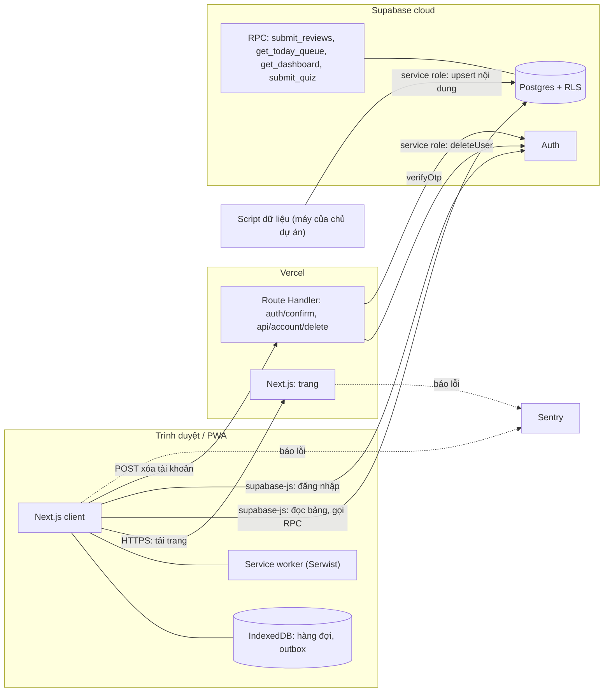
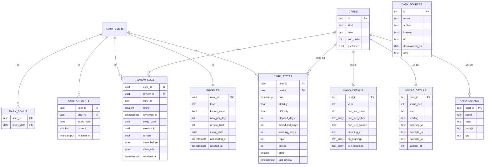
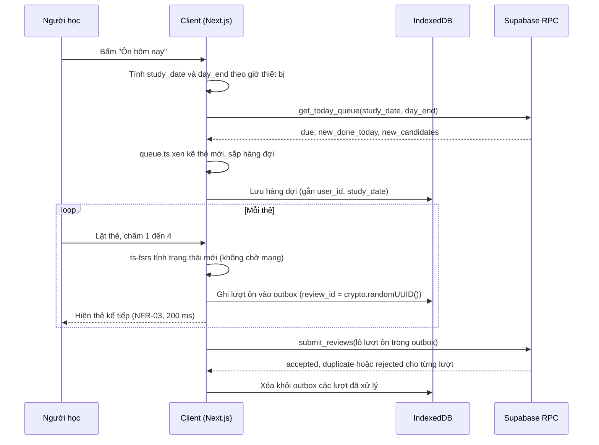
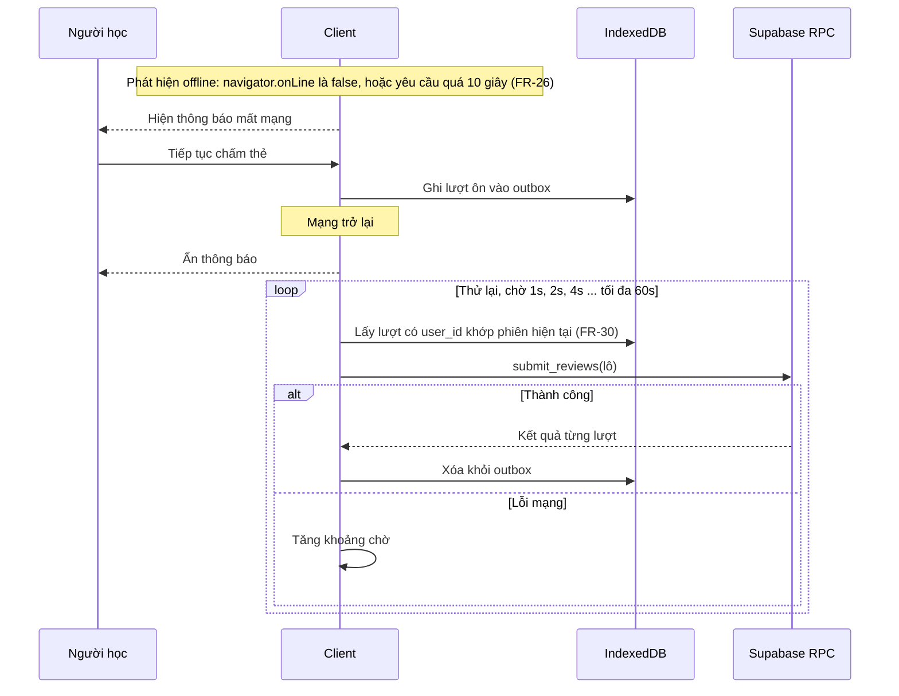
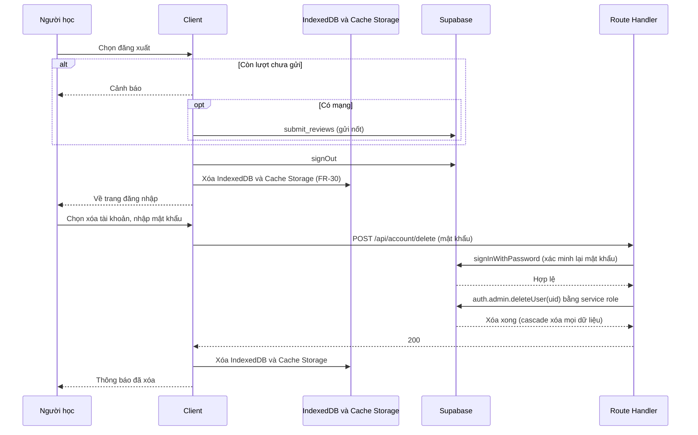
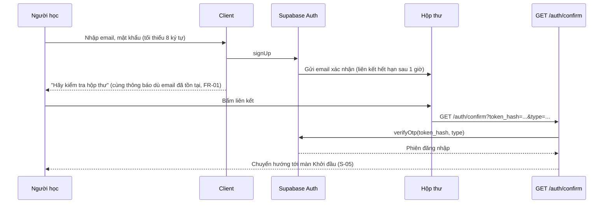
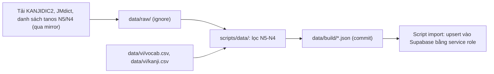

# Kiến trúc kỹ thuật — Nihongo MVP

Trạng thái: Đã chốt quyết định — 18/11/2026

Tài liệu này thuộc giai đoạn 3 (Kiến trúc kỹ thuật) của `docs/00-plan.md`.

## 1. Mục đích và phạm vi

Tài liệu mô tả cách xây Nihongo MVP: thành phần, dữ liệu, API, luồng chính, bảo mật, kiểm thử. Phạm vi là MVP JLPT N5–N4, giao diện tiếng Việt.

Liên kết:

- Yêu cầu: `docs/02-srs.md` (mã FR, NFR, mục 9 "Quyết định chi tiết").
- Tầm nhìn và quyết định giai đoạn 0: `docs/01-vision.md` mục 10.
- Màn hình và khung điều hướng: `docs/03-design.md`.
- Lý do của từng quyết định lớn: `docs/adr/` (ADR-0001 đến ADR-0007).

Cách đọc: mục 2–6 là bức tranh tĩnh (thành phần, dữ liệu, API). Mục 7–15 là hành vi và chất lượng. Mục 16 là lộ trình học cho chủ dự án. Mục 17 là vấn đề mở.

## 2. Tổng quan hệ thống



Giải thích ngắn:

- **Next.js** là framework React. Nó chạy cả trên máy chủ (Vercel) lẫn trong trình duyệt. Một dự án Next.js chứa cả trang giao diện và vài điểm cuối API nhỏ.
- **App Router** là cách Next.js đặt route theo thư mục: thư mục `src/app/xyz/page.tsx` thành đường dẫn `/xyz`.
- **Route Handler** là file `route.ts` trong `src/app/`. Nó là một hàm chạy trên máy chủ, trả lời HTTP (giống một endpoint Express nhỏ).
- Trình duyệt nói chuyện thẳng với Supabase cho phần lớn việc đọc/ghi. Bảo vệ dữ liệu bằng RLS và RPC (mục 5, 6). Vercel chỉ lo hai việc cần khóa bí mật hoặc cần cookie phía máy chủ: xác nhận email và xóa tài khoản.
- Không có backend riêng (ADR-0001).

### 2.1 Bảng công nghệ

| Phần | Công nghệ | Ghi chú |
|---|---|---|
| Framework | Next.js (App Router) | Trang, Route Handler, build cho Vercel |
| Ngôn ngữ | TypeScript | Kiểu tĩnh, bắt lỗi sớm |
| Giao diện | Tailwind CSS | Token theo `docs/03-design.md` mục 5 |
| Supabase client | `@supabase/ssr` + `@supabase/supabase-js` | `@supabase/ssr` giữ phiên đăng nhập trong cookie, dùng được ở cả máy chủ lẫn trình duyệt |
| FSRS | `ts-fsrs` | Ghim phiên bản chính xác (không dùng `^` hay `~`) |
| Service worker | Serwist, gói `@serwist/next` | Precache vỏ ứng dụng |
| IndexedDB | `idb` | Bọc IndexedDB bằng Promise |
| Unit test | Vitest | |
| E2E | Playwright, chỉ Chromium | |
| Deploy | Vercel | |
| Giám sát lỗi | Sentry | Cấu hình ở mục 12 |
| Quản lý gói | pnpm | |
| CSDL, đăng nhập | Supabase cloud (Postgres, Auth) | Không chạy Supabase trên máy |

## 3. Môi trường

Hai project Supabase cloud (ADR-0007):

| Project | Dùng cho |
|---|---|
| `nihongo-dev` | Phát triển, test tích hợp, E2E, tài khoản test |
| `nihongo-prod` | Người dùng thật, chỉ ra mắt từ giai đoạn 7 |

- Không Docker, không Supabase local.
- Migration viết bằng SQL trong `supabase/migrations/`. Áp dụng bằng Supabase CLI: `supabase link` (trỏ tới project) rồi `supabase db push`. Quy trình: push lên `nihongo-dev`, kiểm thử, sau đó push lên `nihongo-prod`.
- Vercel có hai nhóm biến môi trường: Preview/Development trỏ `nihongo-dev`, Production trỏ `nihongo-prod`.

### 3.1 Biến môi trường

| Biến | Công khai? | Dùng ở đâu |
|---|---|---|
| `NEXT_PUBLIC_SUPABASE_URL` | Có | Trình duyệt và máy chủ |
| `NEXT_PUBLIC_SUPABASE_ANON_KEY` | Có (khóa publishable/anon, an toàn khi công khai vì có RLS) | Trình duyệt và máy chủ |
| `SUPABASE_SERVICE_ROLE_KEY` | Không. Chỉ máy chủ | Route Handler xóa tài khoản và script dữ liệu. Không bao giờ đặt tên có tiền tố `NEXT_PUBLIC_` |
| `SENTRY_DSN` | Không công khai trong repo | Máy chủ và client |

Quy tắc:

- Next.js chỉ đưa biến có tiền tố `NEXT_PUBLIC_` vào gói gửi cho trình duyệt. Đây là lý do khóa service role không được có tiền tố này.
- Lưu ở `.env.local` (đã ignore) khi làm việc trên máy, và ở biến môi trường của Vercel khi deploy. Không commit khóa.
- NFR-13: CI quét gói build tìm chuỗi của khóa service role; thấy là CI thất bại.

## 4. Cấu trúc thư mục

Một app Next.js, không monorepo.

```text
nihongo/
├─ src/
│  ├─ app/
│  │  ├─ (public)/             đăng nhập, đăng ký, quên mật khẩu, nguon-du-lieu
│  │  ├─ (app)/                trang chính, ôn, kana, trắc nghiệm, cài đặt, khởi đầu
│  │  ├─ auth/confirm/route.ts
│  │  └─ api/account/delete/route.ts
│  ├─ lib/
│  │  ├─ domain/               hàm thuần, có unit test
│  │  │  ├─ study-day.ts
│  │  │  ├─ fsrs.ts
│  │  │  ├─ queue.ts
│  │  │  ├─ streak.ts
│  │  │  ├─ xp.ts
│  │  │  ├─ quiz.ts
│  │  │  └─ estimate.ts
│  │  ├─ supabase/             client trình duyệt, client máy chủ, middleware làm mới phiên
│  │  └─ offline/              IndexedDB, outbox gửi lại
│  ├─ components/
│  └─ sw.ts                    service worker
├─ supabase/migrations/        SQL migration
├─ scripts/data/               pipeline dữ liệu (TypeScript chạy bằng Node)
├─ data/                       dữ liệu dẫn xuất đã commit
│  ├─ build/                   JSON xuất ra, nạp vào Supabase
│  ├─ vi/                      nghĩa tiếng Việt tự biên soạn (CSV)
│  ├─ raw/                     bản tải gốc (ignore, không commit)
│  └─ LICENSE.md               nguồn và giấy phép dữ liệu
└─ tests/e2e/                  Playwright
```

Ghi chú:

- Thư mục có ngoặc như `(public)` và `(app)` là **route group**: dùng để gom trang và dùng chung layout, tên trong ngoặc không xuất hiện trong URL. `(public)` gồm trang không cần đăng nhập, kể cả `/nguon-du-lieu` (FR-29). `(app)` gồm trang cần đăng nhập và xác nhận email.
- `src/lib/domain/` chỉ chứa hàm thuần (nhận vào dữ liệu, trả ra kết quả, không gọi mạng, không đọc giờ hệ thống trực tiếp). Nhờ vậy test bằng Vitest dễ (NFR-21).
- `middleware` trong `src/lib/supabase/` chạy trước mỗi yêu cầu trang để làm mới phiên đăng nhập trong cookie (mẫu chuẩn của `@supabase/ssr`).

## 5. Mô hình dữ liệu

### 5.1 ERD



`DATA_SOURCES` không có quan hệ với bảng nào, nó chỉ phục vụ trang FR-29.

### 5.2 Bảng nội dung (chỉ đọc)

RLS cho `anon` và `authenticated` chỉ có `SELECT`. Không ai ghi được từ trình duyệt. Chỉ script dữ liệu ghi, bằng service role (service role bỏ qua RLS).

**`cards`**

| Cột | Kiểu | Mô tả |
|---|---|---|
| `id` | text PK | Mã ổn định: `kana:hira:ka`, `vocab:<jmdict_seq>`, `kanji:学` |
| `kind` | text | `check in ('kana','vocab','kanji')` |
| `level` | text null | `check in ('N5','N4')`; kana để null |
| `sort_order` | int | Thứ tự trong danh sách nguồn |
| `published` | bool | Chỉ thẻ đã đủ nghĩa tiếng Việt mới vào hàng đợi thẻ mới |

**`kana_details`**: `card_id` PK + FK; `script` (`'hira'` hoặc `'kata'`); `kana`; `romaji`; `grp` (`'basic'`, `'dakuten'`, `'yoon'`).

**`vocab_details`**: `card_id` PK + FK; `jmdict_seq` int; `word`; `reading`; `meaning_vi`; `example_ja` null; `example_vi` null; `tatoeba_id` int null.

**`kanji_details`**: `card_id` PK + FK; `kanji`; `han_viet_main` text null; `han_viet_other` text[]; `han_viet_source` (`'kanjidic2'` hoặc `'manual'`); `meaning_vi`; `on_readings` text[]; `kun_readings` text[].

- Từ ví dụ của kanji suy ra bằng truy vấn trên `vocab_details` có chứa chữ đó (FR-14), không lưu riêng.
- `han_viet_main` null thì giao diện hiện "Đang bổ sung" (FR-14).

**`data_sources`**: `id`, `name`, `author`, `license`, `url`, `downloaded_on` date, `note`. Nguồn cho trang FR-29.

### 5.3 Bảng người dùng

Mọi bảng có `user_id uuid references auth.users on delete cascade` và bật RLS. Xóa một dòng `auth.users` kéo theo xóa hết dữ liệu (FR-05).

**`profiles`**

| Cột | Kiểu | Mô tả |
|---|---|---|
| `user_id` | uuid PK | |
| `level` | text, default `'N5'` | Cấp học |
| `knows_kana` | bool, default false | |
| `new_per_day` | int, check 5..30, default 10 | FR-08 |
| `review_limit` | int, check 50..500, default 100 | FR-08 |
| `exam_date` | date null | FR-07 |
| `onboarded_at` | timestamptz null | Null nghĩa là chưa xong màn Khởi đầu |
| `created_at` | timestamptz | |

- Tạo tự động bằng trigger khi có bản ghi mới trong `auth.users`.
- Policy SELECT và UPDATE: `USING (user_id = auth.uid()) WITH CHECK (user_id = auth.uid())`.
- Người dùng cập nhật cài đặt trực tiếp qua bảng này (supabase-js). Các `check` ở cột bảo đảm khoảng giá trị ở mức CSDL.

**`card_states`**: `user_id`, `card_id` FK `cards`, `due`, `stability`, `difficulty`, `elapsed_days`, `scheduled_days`, `learning_steps`, `reps`, `lapses`, `state` smallint, `last_review` timestamptz. PK (`user_id`, `card_id`). Index (`user_id`, `due`). Các cột khớp với đối tượng thẻ của `ts-fsrs`.

**`review_logs`**

| Cột | Kiểu | Mô tả |
|---|---|---|
| `user_id`, `review_id` | uuid | PK (`user_id`, `review_id`). `review_id` do thiết bị tạo |
| `card_id` | text | |
| `rating` | smallint, check 1..4 | Lại, Khó, Được, Dễ |
| `reviewed_at` | timestamptz | UTC |
| `study_date` | date | Ngày học tính trên thiết bị lúc chấm (FR-09) |
| `session_id` | uuid | Đo thời gian phiên |
| `is_new` | bool | Lượt đầu tiên của thẻ |
| `state_before`, `state_after` | jsonb | Trạng thái FSRS trước và sau |
| `received_at` | timestamptz, default `now()` | Lúc máy chủ nhận |

Index (`user_id`, `study_date`).

**`quiz_attempts`**: `user_id`, `quiz_id` uuid, `study_date`, `correct` smallint check 0..10, `finished_at`. PK (`user_id`, `quiz_id`).

**`daily_bonus`**: `user_id`, `study_date`. PK (`user_id`, `study_date`). Mốc +5 XP đã nhận (FR-23).

### 5.4 Quyền ghi

- `card_states`, `review_logs`, `quiz_attempts`, `daily_bonus`: chỉ có policy SELECT theo `user_id = auth.uid()`. KHÔNG cấp INSERT/UPDATE/DELETE cho `authenticated` (dùng `revoke`). Mọi ghi đi qua RPC ở mục 6 (ADR-0003).
- `profiles`: người dùng đọc và sửa dòng của mình. Không có INSERT/DELETE từ trình duyệt (INSERT do trigger).

### 5.5 Ghi chú NFR-15 và số tính khi đọc

Các bảng ở mục 5.3 là toàn bộ dữ liệu người dùng (cộng email trong `auth.users`). XP, chuỗi ngày và tổng ngày học được TÍNH khi đọc, không lưu cột riêng, để tránh số lệch nhau:

- XP = số dòng `review_logs` + tổng `correct` của `quiz_attempts` + 5 × số dòng `daily_bonus`.
- Tổng ngày học = số `study_date` khác nhau trong `review_logs`.
- Chuỗi tính theo FR-22 từ các `study_date` khác nhau.

## 6. API

### 6.1 Đọc trực tiếp

Đọc nội dung (`cards` và bảng chi tiết), `profiles`, `card_states` bằng supabase-js từ trình duyệt. RLS bảo vệ.

### 6.2 RPC Postgres

RPC (remote procedure call) ở đây là hàm Postgres do client gọi qua supabase-js: `supabase.rpc('ten_ham', {...})`.

Quy tắc chung cho mọi RPC:

- `SECURITY DEFINER`, `set search_path = ''` (viết tên bảng đầy đủ schema, ví dụ `public.review_logs`).
- Đầu hàm: từ chối nếu `auth.uid()` là null.
- `revoke execute ... from public, anon`; chỉ `grant execute ... to authenticated`.
- `user_id` luôn lấy từ `auth.uid()`, không nhận từ tham số.

**`submit_reviews(p_reviews jsonb) returns table(review_id uuid, status text)`**

- Lô tối đa 200 lượt. `status` là `'accepted'`, `'duplicate'` hoặc `'rejected'`.
- Với từng lượt:
  1. Từ chối (`rejected`) nếu thẻ không tồn tại, hoặc `reviewed_at > now() + 5 phút`, hoặc `study_date` lệch quá 2 ngày so với ngày UTC của `reviewed_at` (kiểm tra hợp lý).
  2. Insert vào `review_logs` với `ON CONFLICT (user_id, review_id) DO NOTHING`. Nếu trùng thì `duplicate` và không làm gì thêm (NFR-19).
  3. Nếu ghi mới: upsert `card_states`, chỉ khi `reviewed_at` mới hơn `last_review` hiện có (FR-27, lượt mới hơn thắng).
  - `is_new` do máy chủ suy ra, bỏ qua giá trị client gửi: lượt là "mới" khi trước nó chưa có dòng `card_states` cho thẻ đó. Trong một lô, xử lý các lượt theo `reviewed_at` tăng dần để suy đúng.
- Sau cả lô, với mỗi `study_date` bị ảnh hưởng: nếu số lượt `is_new` trong ngày đó ≥ `profiles.new_per_day` hiện tại thì insert `daily_bonus` `on conflict do nothing`.
- Toàn bộ trong một transaction.

**`get_today_queue(p_study_date date, p_day_end timestamptz) returns jsonb`**

- `due`: thẻ có `due < p_day_end`, sắp `due` tăng dần (quá hạn lâu nhất trước), giới hạn `review_limit`, kèm nội dung thẻ và trạng thái.
- `new_done_today`: số lượt `is_new` trong `p_study_date`.
- `new_candidates`: tối đa `new_per_day` thẻ chưa học cho mỗi loại: kana (nếu chưa biết kana); kanji và vocab theo `level` và `sort_order`, chỉ thẻ `published`.
- Việc xen kẽ 1 kanji : 2 từ vựng và "kana trước" (FR-13) làm ở client trong `queue.ts` (hàm thuần, test được). Client cũng cắt số thẻ mới còn lại = `new_per_day` − `new_done_today`.
- `p_study_date` và `p_day_end` do client tính theo giờ thiết bị (FR-09). Máy chủ không biết múi giờ người dùng.

**`get_dashboard(p_study_date date) returns jsonb`**

Trả: `due_count`, `new_done_today`, `new_per_day`, `streak`, `total_days`, `xp_total`, `xp_today`, `median_seconds_7d`, `exam_date`.

- `median_seconds_7d`: trung vị chênh lệch `reviewed_at` giữa hai lượt liên tiếp trong cùng `session_id`, trên 7 ngày học gần nhất. Null nếu chưa đủ dữ liệu; khi đó client dùng 20 giây (FR-21).
- Chuỗi và tổng ngày tính từ `study_date` khác nhau của `review_logs` theo FR-22: hôm nay chưa học nhưng hôm qua có học thì chuỗi giữ.

**`submit_quiz(p_quiz_id uuid, p_study_date date, p_correct int)`**

Idempotent theo (`user_id`, `quiz_id`). Không chạm `card_states` hay `review_logs` (FR-20). Trắc nghiệm cần mạng ở MVP: khi offline, màn trắc nghiệm hiện thông báo FR-26 và không mở bài mới.

### 6.3 Route Handler (chạy trên Vercel)

**`GET /auth/confirm`**: xác nhận email và đặt lại mật khẩu. Dùng `verifyOtp` với `token_hash` từ liên kết trong email (mẫu chuẩn của `@supabase/ssr`), rồi chuyển hướng.

**`POST /api/account/delete`** (ADR-0006)

- Body: mật khẩu.
- Lấy người dùng từ phiên cookie.
- Xác minh lại mật khẩu bằng `signInWithPassword` (client anon, chịu giới hạn tần suất của Supabase Auth).
- Gọi `auth.admin.deleteUser(uid)` bằng service role. Khóa ngoại `on delete cascade` xóa hết dữ liệu (FR-05).
- Client sau đó xóa IndexedDB và Cache Storage, rồi đăng xuất.

### 6.4 Ánh xạ FR sang bảng, RPC, route

| FR | Thực hiện bằng |
|---|---|
| FR-01, FR-02, FR-04 | Supabase Auth; `GET /auth/confirm` |
| FR-03 | `signOut` + xóa dữ liệu cục bộ (FR-30) |
| FR-05 | `POST /api/account/delete`; cascade từ `auth.users` |
| FR-06, FR-07, FR-08 | Bảng `profiles` (cập nhật trực tiếp) |
| FR-09 | `study-day.ts`; cột `study_date`; tham số của RPC |
| FR-10, FR-11 | `cards`, `kana_details`; `profiles.knows_kana`; `get_today_queue` |
| FR-12 | `vocab_details` |
| FR-13 | `get_today_queue` + `queue.ts` |
| FR-14 | `kanji_details` + truy vấn `vocab_details` |
| FR-15 | `fsrs.ts` (`ts-fsrs`); `card_states` |
| FR-16 | `get_today_queue` |
| FR-17 | `review_logs`; `submit_reviews` |
| FR-18 | Client (màn phiên ôn) |
| FR-19, FR-20 | `quiz.ts`; `submit_quiz` |
| FR-21 | `get_dashboard`; `estimate.ts` |
| FR-22 | `get_dashboard`; `streak.ts` |
| FR-23 | `xp.ts`; `daily_bonus`; `submit_reviews`; `submit_quiz` |
| FR-24 | `profiles.exam_date` |
| FR-25 | Manifest, Serwist, HTTPS của Vercel |
| FR-26, FR-27, FR-28 | `src/lib/offline/`; `submit_reviews` |
| FR-29 | `data_sources`; trang `/nguon-du-lieu` |
| FR-30 | `src/lib/offline/` (gắn `user_id`, xóa khi đăng xuất) |

## 7. Luồng chính

### 7.1 Phiên ôn



- Outbox gửi theo lô (tối đa 200 lượt mỗi lần), không cần đợi hết phiên: gửi định kỳ khi có lượt chưa gửi và có mạng.
- Lượt `rejected` bị xóa khỏi outbox và ghi lỗi ra Sentry (không kèm nội dung thẻ). Lượt `duplicate` coi như đã gửi xong.
- Hàng đợi lưu trong IndexedDB gắn `user_id` và `study_date`. Mở lại app cùng tài khoản và cùng ngày học thì tiếp tục phiên (FR-28).

### 7.2 Mất mạng và gửi lại



Outbox thử gửi khi:

- có sự kiện `online`;
- người dùng mở app;
- bộ hẹn giờ đến hạn (khoảng chờ tăng dần).

Không dựa vào Background Sync vì Safari iOS không hỗ trợ (ADR-0004). Outbox chỉ gửi bản ghi có `user_id` khớp phiên hiện tại. Bản ghi của tài khoản khác nằm yên cho đến khi đúng tài khoản đăng nhập lại, hoặc bị xóa khi đăng xuất (7.3).

### 7.3 Đăng xuất và xóa tài khoản



- Đăng xuất khi offline mà vẫn còn lượt chưa gửi: sau cảnh báo, nếu người dùng vẫn đăng xuất thì xóa dữ liệu cục bộ, chấp nhận mất lượt chưa gửi (FR-30, ưu tiên riêng tư máy dùng chung).
- Mật khẩu sai: Route Handler trả lỗi, không xóa gì (UC-06 3b). Lỗi xóa giữa chừng: trả lỗi, không báo "đã xóa" (UC-06 4a).

### 7.4 Đăng ký và xác nhận email



Luồng đặt lại mật khẩu dùng cùng route `/auth/confirm` với `type` khác, rồi chuyển tới bước 2 của S-03.

## 8. Offline và PWA

- **Serwist** precache vỏ ứng dụng (HTML/JS/CSS/font/biểu tượng) và các trang công khai. Service worker là file `src/sw.ts`.
- Service worker KHÔNG cache phản hồi API/Supabase hay dữ liệu cá nhân. Dữ liệu cá nhân chỉ nằm ở IndexedDB. Vì vậy đăng xuất xóa IndexedDB là đủ; vẫn xóa Cache Storage khi đăng xuất cho chắc (FR-30).
- Manifest, biểu tượng và HTTPS (Vercel) đáp ứng FR-25.
- Safari iOS không có nút cài tự động: hướng dẫn "Thêm vào màn hình chính" nằm trong Cài đặt (FR-25).
- MVP không ôn offline hoàn toàn (SRS mục 8): chỉ ôn tiếp phiên đã tải và gửi lại sau.

## 9. Tính thời gian (FR-09)

- `study-day.ts` dùng giờ địa phương của thiết bị, ranh giới 4:00. Ví dụ: 02:00 ngày 19 thì `study_date` là ngày 18.
- `day_end` là 4:00 sáng hôm sau (theo giờ thiết bị) của ngày học hiện tại, đổi sang UTC để gửi lên máy chủ.
- Máy chủ lưu `reviewed_at` (UTC) và `study_date` do client gửi. Không tính lại dữ liệu quá khứ khi đổi múi giờ.
- Hàm nhận thời điểm và múi giờ làm tham số (không đọc `Date.now()` bên trong) để unit test được các trường hợp biên: 03:59, 04:00, đổi giờ mùa hè, đổi múi giờ.

## 10. FSRS (ADR-0002)

- Dùng `ts-fsrs` với tham số mặc định, ghim phiên bản chính xác. Đổi phiên bản là một thay đổi có chủ ý, vì kết quả lên lịch có thể đổi.
- Client tính trạng thái mới bằng `fsrs.ts` ngay khi chấm. Máy chủ lưu và tin trạng thái client gửi.
- Chấp nhận rủi ro: người dùng sửa được lịch của chính mình. Không ảnh hưởng người khác, không có bảng xếp hạng.

## 11. Pipeline dữ liệu (ADR-0005)



1. Tải KANJIDIC2 và JMdict (EDRDG) và danh sách tanos N5/N4 vào `data/raw/` (ignore). Danh sách tanos lấy qua repo mirror, ghi rõ nguồn thứ cấp.
2. `scripts/data/` lọc N5–N4 và ghép nghĩa tiếng Việt từ `data/vi/vocab.csv`, `data/vi/kanji.csv`. Cột: `card_id`, `meaning_vi`, ghi chú, người biên soạn.
3. Xuất `data/build/*.json` (commit, giấy phép CC BY-SA). `data/LICENSE.md` ghi nguồn.
4. Script import upsert vào Supabase bằng service role, chạy tay trên máy của chủ dự án.

Ghi chú:

- Nghĩa tiếng Việt biên soạn dần theo sprint. Thẻ chưa có nghĩa thì `published = false` và chưa vào hàng đợi thẻ mới.
- Độ phủ âm Hán Việt (`r_type="vietnam"`): Đo ngày 18/11/2026 (KANJIDIC2 database_version 2026-322; danh sách tanos qua mirror Bluskyo/JLPT_Vocabulary commit d29a678): N5 79/79 và N4 166/166 kanji có âm Hán Việt (100%); 75 chữ có từ 2 âm trở lên. KANJIDIC2 xếp các âm theo bảng chữ cái, không theo mức phổ biến (山: San, Sơn; 国: Quốc, Cuốc), và lưu dạng chữ hoa đầu, nhiều âm chưa chuẩn hóa NFC. Pipeline phải chuẩn hóa NFC mọi chuỗi Hán Việt; `han_viet_main` chọn tay trong `data/vi/kanji.csv` (cột `han_viet_main`), kanji chưa chọn âm chính thì `published = false`; hiển thị viết HOA ở giao diện, lưu dạng gốc đã NFC. Kanji thiếu thì bổ sung tay, `han_viet_source = 'manual'`.
- Bản gốc không commit; dữ liệu dẫn xuất giữ CC BY-SA, tách khỏi giấy phép MIT của mã nguồn.

### 11.1 Nhập `data_sources`

Script import cũng upsert `data_sources` (tên, tác giả, giấy phép, url, ngày tải) từ `data/LICENSE.md` hoặc một file cấu hình trong `scripts/data/`. Trang `/nguon-du-lieu` chỉ đọc bảng này, nên không có nguồn nào hiện trên trang mà không có trong dữ liệu (FR-29, NFR-23).

## 12. Bảo mật

Bảng kiểm, ánh xạ NFR-12, 13, 14, 24, 25:

| Hạng mục | Cách làm | NFR |
|---|---|---|
| RLS mọi bảng | Bảng người dùng: theo `user_id = auth.uid()`. Bảng nội dung: chỉ SELECT | NFR-12 |
| RPC | `SECURITY DEFINER`, `search_path = ''`, từ chối khi `auth.uid()` null, chỉ `authenticated` được gọi | NFR-12, NFR-19 |
| Ghi trực tiếp | `revoke` INSERT/UPDATE/DELETE trên `card_states`, `review_logs`, `quiz_attempts`, `daily_bonus` | NFR-12 |
| Service role | Chỉ ở máy chủ (Route Handler, script dữ liệu). CI quét gói build | NFR-13 |
| Mật khẩu | Do Supabase Auth quản lý, ứng dụng không lưu hay ghi log | NFR-14 |
| Rate limit | Giới hạn của Supabase Auth cho đăng ký, đăng nhập, gửi lại email, quên mật khẩu, và cho `signInWithPassword` ở bước xóa tài khoản | NFR-24 |
| Sentry | `sendDefaultPii: false`; `beforeSend` xóa body và request data; không session replay; không gửi nội dung thẻ | NFR-25 |
| Cookie | Chỉ cookie đăng nhập; không cookie theo dõi | NFR-16 |

Giới hạn đã biết:

- Sau khi xóa tài khoản, JWT truy cập đã cấp còn hạn đến khi hết hạn (mặc định 1 giờ), nhưng không còn dữ liệu nào để đọc. Refresh token bị thu hồi.
- Bản sao lưu của Supabase còn giữ dữ liệu theo chu kỳ của nhà cung cấp (NFR-17).

Rủi ro đã chấp nhận:

- Client gửi `p_correct` sai để tự tăng XP. Chấp nhận vì không có bảng xếp hạng.

## 13. Email

SMTP mặc định của Supabase giới hạn rất thấp, chỉ đủ khi phát triển. Trước khi ra mắt phải cấu hình SMTP riêng (ví dụ Resend gói miễn phí). Đây là việc của giai đoạn 7. Mẫu email (xác nhận, đặt lại mật khẩu) viết bằng tiếng Việt.

## 14. Kiểm thử (NFR-21, NFR-22)

| Loại | Công cụ | Phạm vi |
|---|---|---|
| Unit | Vitest | `src/lib/domain/*`: lịch FSRS 4 mức, chuỗi ngày, XP, ranh giới 4:00, hàng đợi, trắc nghiệm, ước tính thời gian |
| Tích hợp RLS/RPC | Vitest chạy với `nihongo-dev`, hai tài khoản test | A không đọc/ghi được dữ liệu B; gửi trùng `review_id` chỉ một bản ghi; `user_id` giả mạo bị bỏ qua |
| E2E | Playwright Chromium | Đăng ký/đăng nhập, chọn cấp, phiên ôn, trắc nghiệm, mất mạng rồi gửi lại, xóa tài khoản. Mất mạng mô phỏng bằng `context.setOffline` |

CI (GitHub Actions) chạy cho mỗi lần push, mọi nhánh: lint, typecheck, unit test, build, quét khóa trong gói build. Test tích hợp và E2E chạy khi có secret của project dev (secret nằm trong GitHub Actions secrets, không trong repo).

## 15. Hiệu năng (NFR-01..03)

- Trang công khai render phía máy chủ.
- Màn học là client component (component chạy trong trình duyệt) để chạy được khi offline.
- Font tự host qua `next/font`. Chỉ nạp tập con cần thiết của Noto Sans JP và Klee One nếu khả thi. Cần đo kích thước và LCP thực tế trước khi chốt.
- NFR-03 (chấm thẻ ≤ 200 ms): không có lệnh gọi mạng trên đường chấm thẻ. Ghi IndexedDB chạy không đồng bộ, không chặn việc hiện thẻ kế tiếp.

## 16. Lộ trình học cho chủ dự án trước sprint 1

Thứ tự đề xuất, theo cái dự án thật sự dùng:

- React cơ bản: component, props, state, `useEffect`, danh sách và sự kiện.
- TypeScript cơ bản: kiểu, interface, kiểu union, generic ở mức đọc hiểu.
- Next.js App Router: cấu trúc thư mục `app/`, server component và client component (`"use client"`), layout, route group, Route Handler.
- `@supabase/ssr`: tạo client cho trình duyệt và máy chủ, middleware làm mới phiên, luồng `verifyOtp`.
- Làm một bài tập nhỏ end to end: đăng ký, đăng nhập, đọc một bảng có RLS.
- Đọc tài liệu chính thức của từng công cụ ở trên khi bắt tay vào làm.

## 17. Vấn đề mở

Đã chốt 18/11/2026 (SRS đã sửa theo): điểm 1, 2, 3, 4 cập nhật chữ trong SRS (NFR-12, FR-27, NFR-15, mục 1.3); điểm 5 dùng bộ dữ liệu mẫu chung `tests/fixtures/streak-xp.json` chạy cho cả unit test (`streak.ts`, `xp.ts`) và test tích hợp `get_dashboard`, `get_dashboard` là nguồn chính, client chỉ cộng tạm +1 XP cho lượt còn trong outbox; điểm 6 trắc nghiệm cần mạng ở MVP; điểm 9 máy chủ suy `is_new` (mục 6.2), `p_correct` vẫn là rủi ro chấp nhận. Điểm 7, 8, 10, 11 là việc kiểm chứng ở giai đoạn 4 hoặc khi dựng màn tương ứng.

Các điểm gốc:

1. **NFR-12 và bảng chỉ đọc.** NFR-12 viết "mọi bảng dữ liệu người dùng bật RLS với chính sách có cả `USING` và `WITH CHECK`". Ở thiết kế này chỉ `profiles` có cả hai. Bốn bảng còn lại chỉ có policy SELECT (không có WITH CHECK vì không cho ghi trực tiếp). Bảo vệ mạnh hơn, nhưng chữ của NFR-12 nên được chỉnh cho khớp.
2. **FR-27 và kiểm tra `study_date`.** SRS chỉ yêu cầu từ chối `reviewed_at` muộn quá 5 phút và thẻ không tồn tại. Thiết kế thêm kiểm tra `study_date` lệch quá 2 ngày so với ngày UTC của `reviewed_at`. Đây là bổ sung, không mâu thuẫn. Có thể thêm vào FR-27.
3. **NFR-15 và cột phụ.** Thiết kế có thêm `onboarded_at`, `created_at`, `received_at`, `state_before`/`state_after` và `quiz_attempts.correct`. Chúng thuộc nhóm cài đặt, log ôn và XP đã liệt kê, nhưng NFR-15 nên kể tên rõ hơn (ví dụ "kết quả trắc nghiệm").
4. **Định nghĩa "đến hạn".** SRS mục 1.3 định nghĩa đến hạn là `due` ≤ hiện tại. Hàng đợi (FR-16) dùng `due < day_end` (cuối ngày học). Hai điều này cùng đúng nhưng nên ghi rõ trong SRS: "đến hạn hôm nay" nghĩa là đến hạn trước cuối ngày học.
5. **Streak và XP có hai nơi tính.** `streak.ts` và `xp.ts` (client, unit test cho NFR-21, hiển thị tức thì khi offline) và `get_dashboard` (SQL, nguồn chính khi online). Hai nơi phải cho cùng kết quả. Cách chống lệch (ví dụ test chung bộ dữ liệu mẫu) chưa chốt.
6. **Trắc nghiệm khi offline.**

   > CẦN QUYẾT: Trắc nghiệm có chạy khi mất mạng không? SRS không nói. Hiện `submit_quiz` cần mạng. Phương án gợi ý: trắc nghiệm cần mạng ở MVP, hiển thị thông báo FR-26; hoặc thêm kết quả trắc nghiệm vào outbox.

7. **Mở app khi offline và phiên đăng nhập.** FR-28 yêu cầu mở lại app offline vẫn tiếp tục phiên. Nếu trang trong `(app)` phụ thuộc middleware làm mới phiên trên Vercel thì khi offline không có phản hồi. Cần kiểm chứng khi dựng khung rằng vỏ ứng dụng precache khởi động được và kiểm tra đăng nhập ở client dùng phiên cục bộ. Cần thử thật trước sprint có phiên ôn.
8. **Serwist và bundler của Next.js.** Chưa xác minh `@serwist/next` chạy với bundler mặc định của phiên bản Next.js sẽ dùng. Kiểm tra ở giai đoạn 4 (dựng repo) và ghi kết quả vào ADR-0004 nếu phải đổi cấu hình.
9. **Cờ `is_new` và `p_correct` do client gửi.** Máy chủ không kiểm tra được thẻ có thật sự mới. Cùng loại rủi ro với XP, chấp nhận (mục 12). Nếu muốn chặt hơn, RPC có thể suy `is_new` từ việc `card_states` chưa có dòng cho thẻ đó.
10. **Hành vi đăng ký email trùng (FR-01).** Việc Supabase Auth trả cùng phản hồi cho email đã tồn tại phụ thuộc cấu hình project. Cần kiểm tra thực tế trên `nihongo-dev` khi dựng màn đăng ký.
11. **Tham số `ts-fsrs` và tên cột.** Cột `learning_steps` khớp phiên bản `ts-fsrs` có trường này. Khi ghim phiên bản phải đối chiếu tên trường của đối tượng thẻ với cột `card_states`.
